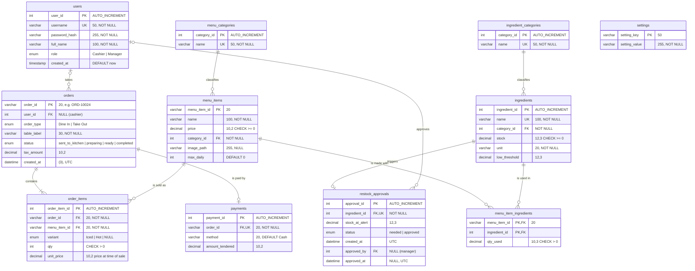

# Bloom & Brew Café — Database Design

Database: **`bloom_brew_pos`** (MySQL / MariaDB 10.4, XAMPP) · Notation: **Crow's Foot** · Normalized to **3NF**

Files: [`schema.sql`](schema.sql) (tables, keys, constraints) · [`bloom_and_brew_sample_data.sql`](bloom_and_brew_sample_data.sql) (sample records)

---

## 1. Overview of the proposed system

Bloom & Brew Café currently runs on handwritten order slips and manual stock counts, which leads to lost orders, kitchen delays and ingredients running out without warning. The proposed system is a web-based **Point-of-Sale and inventory system** that connects the café's main processes:

1. **Login.** Staff sign in with their own account (Cashier or Manager).
2. **Ordering.** The cashier builds an order from the menu (Dine In with a table, or Take Out), takes cash payment and sends it to the kitchen.
3. **Kitchen queue.** Orders move through *sent to kitchen → preparing → ready → completed*.
4. **Inventory.** Every sale automatically deducts the ingredients used, based on each menu item's recipe.
5. **Manager approval.** When an ingredient falls below its low-stock threshold, an alert is raised and a manager approves the restock.
6. **Settings and reports.** The manager sets the tax rate and menu prices, and the dashboard shows sales and stock status.

The database stores all of this data so it is kept between sessions and shared by every terminal.

## 2. Data stored and managed

| Data | Examples |
|---|---|
| Staff accounts | username, password (stored as a bcrypt hash), full name, role |
| Menu | item name, price, category, photo, daily limit |
| Inventory | ingredient name, category, stock on hand, unit, low-stock threshold |
| Recipes | how much of each ingredient one serving uses |
| Sales | orders, the items in each order, the cashier, the table, status, tax |
| Payments | payment method, cash tendered (change is calculated) |
| Restock alerts | which ingredient is low, the stock when the alert was raised, who approved it and when |
| System settings | tax rate, last order number |

## 3. Entities and their purpose

| # | Entity (table) | Purpose |
|---|---|---|
| 1 | `users` | Staff who log in to the system; records who took each order and who approved each restock |
| 2 | `menu_categories` | Groups menu items (Coffee, Ice Shaken, Non-Coffee, Snacks) |
| 3 | `menu_items` | Products the café sells |
| 4 | `ingredient_categories` | Groups ingredients (Dairy, Syrup, Sauce, Pastry, …) |
| 5 | `ingredients` | Raw materials and their current stock (the inventory) |
| 6 | `menu_item_ingredients` | Recipe table. Resolves the many-to-many link between menu items and ingredients |
| 7 | `orders` | One customer transaction (header: cashier, type, table, status, tax, time) |
| 8 | `order_items` | The products inside an order. Resolves the many-to-many link between orders and menu items |
| 9 | `payments` | How an order was paid |
| 10 | `restock_approvals` | Low/out-of-stock alerts and the manager's approval |
| 11 | `settings` | System-wide configuration values (key → value) |

## 4. Entity Relationship Diagram (Crow's Foot)



> GitHub renders this diagram automatically. In VS Code, install the *Markdown Preview Mermaid Support* extension and open the Markdown preview. To get an image for the Word document, paste the code block into https://mermaid.live and export it as PNG or SVG.

### Relationships

| Parent (one) | Child (many) | Foreign key | Cardinality | On delete |
|---|---|---|---|---|
| `menu_categories` | `menu_items` | `menu_items.category_id` | 1 : 0..N | RESTRICT |
| `ingredient_categories` | `ingredients` | `ingredients.category_id` | 1 : 0..N | RESTRICT |
| `menu_items` | `menu_item_ingredients` | `menu_item_ingredients.menu_item_id` | 1 : 0..N | CASCADE |
| `ingredients` | `menu_item_ingredients` | `menu_item_ingredients.ingredient_id` | 1 : 0..N | RESTRICT |
| `users` | `orders` | `orders.user_id` | 0..1 : 0..N | SET NULL |
| `orders` | `order_items` | `order_items.order_id` | 1 : 1..N | CASCADE |
| `menu_items` | `order_items` | `order_items.menu_item_id` | 1 : 0..N | RESTRICT |
| `orders` | `payments` | `payments.order_id` (UNIQUE) | 1 : 0..1 | CASCADE |
| `ingredients` | `restock_approvals` | `restock_approvals.ingredient_id` (UNIQUE) | 1 : 0..1 | CASCADE |
| `users` | `restock_approvals` | `restock_approvals.approved_by` | 0..1 : 0..N | SET NULL |

The two many-to-many relationships are resolved by associative (junction) tables:
- **menu_items ↔ ingredients** through `menu_item_ingredients` (a recipe)
- **orders ↔ menu_items** through `order_items` (the lines of an order)

`settings` is a stand-alone configuration table (key → value). It has no relationship because tax rate and order counter belong to the whole system, not to any one record.

## 5. Data dictionary

PK = primary key · FK = foreign key · UQ = unique · NN = NOT NULL · AI = AUTO_INCREMENT

### users
| Field | Data type | Length | Constraints | Description |
|---|---|---|---|---|
| user_id | INT | 11 | PK, AI | Staff ID |
| username | VARCHAR | 50 | NN, UQ | Login name |
| password_hash | VARCHAR | 255 | NN | bcrypt hash of the password |
| full_name | VARCHAR | 100 | NN | Name shown on orders and receipts |
| role | ENUM | — | NN, 'Cashier' / 'Manager' | Access level |
| created_at | TIMESTAMP | — | NN, DEFAULT CURRENT_TIMESTAMP | Date the account was created |

### menu_categories
| Field | Data type | Length | Constraints | Description |
|---|---|---|---|---|
| category_id | INT | 11 | PK, AI | Category ID |
| name | VARCHAR | 50 | NN, UQ | Category name |

### menu_items
| Field | Data type | Length | Constraints | Description |
|---|---|---|---|---|
| menu_item_id | VARCHAR | 20 | PK | Item code, e.g. `m1` |
| name | VARCHAR | 100 | NN | Item name |
| price | DECIMAL | 10,2 | NN, CHECK ≥ 0 | Current selling price (₱) |
| category_id | INT | 11 | NN, FK → menu_categories | Category |
| image_path | VARCHAR | 255 | NULL | Product photo |
| max_daily | INT | 11 | NN, DEFAULT 0 | Maximum servings per day |

### ingredient_categories
| Field | Data type | Length | Constraints | Description |
|---|---|---|---|---|
| category_id | INT | 11 | PK, AI | Category ID |
| name | VARCHAR | 50 | NN, UQ | Category name |

### ingredients
| Field | Data type | Length | Constraints | Description |
|---|---|---|---|---|
| ingredient_id | INT | 11 | PK, AI | Ingredient ID |
| name | VARCHAR | 100 | NN, UQ | Ingredient name |
| category_id | INT | 11 | NN, FK → ingredient_categories | Category |
| stock | DECIMAL | 12,3 | NN, DEFAULT 0, CHECK ≥ 0 | Quantity on hand |
| unit | VARCHAR | 20 | NN | kg, L, pcs, packs |
| low_threshold | DECIMAL | 12,3 | NN, DEFAULT 0 | A low-stock alert is raised below this level |

### menu_item_ingredients
| Field | Data type | Length | Constraints | Description |
|---|---|---|---|---|
| menu_item_id | VARCHAR | 20 | PK, FK → menu_items (CASCADE) | Menu item |
| ingredient_id | INT | 11 | PK, FK → ingredients | Ingredient |
| qty_used | DECIMAL | 10,3 | NN, CHECK > 0 | Amount used per serving |

### orders
| Field | Data type | Length | Constraints | Description |
|---|---|---|---|---|
| order_id | VARCHAR | 20 | PK | Order number, e.g. `ORD-10024` |
| user_id | INT | 11 | NULL, FK → users (SET NULL) | Cashier who took the order |
| order_type | ENUM | — | NN, 'Dine In' / 'Take Out' | Service type |
| table_label | VARCHAR | 30 | NN | `Table 1`–`Table 10`, `Waiting`, or `Take Out` |
| status | ENUM | — | NN, indexed | sent_to_kitchen / preparing / ready / completed |
| tax_amount | DECIMAL | 10,2 | NN, DEFAULT 0 | Tax charged at the time of sale |
| created_at | DATETIME(3) | — | NN, indexed | Date and time of the order (UTC) |

### order_items
| Field | Data type | Length | Constraints | Description |
|---|---|---|---|---|
| order_item_id | INT | 11 | PK, AI | Line ID |
| order_id | VARCHAR | 20 | NN, FK → orders (CASCADE) | Order |
| menu_item_id | VARCHAR | 20 | NN, FK → menu_items | Product sold |
| variant | ENUM | — | NULL, 'Iced' / 'Hot' | Coffee temperature |
| qty | INT | 11 | NN, CHECK > 0 | Quantity |
| unit_price | DECIMAL | 10,2 | NN | Price per unit when sold (Iced adds ₱5) |

UNIQUE (order_id, menu_item_id, variant)

### payments
| Field | Data type | Length | Constraints | Description |
|---|---|---|---|---|
| payment_id | INT | 11 | PK, AI | Payment ID |
| order_id | VARCHAR | 20 | NN, UQ, FK → orders (CASCADE) | Order paid (one payment per order) |
| method | VARCHAR | 20 | NN, DEFAULT 'Cash' | Payment method |
| amount_tendered | DECIMAL | 10,2 | NN | Cash received |

### restock_approvals
| Field | Data type | Length | Constraints | Description |
|---|---|---|---|---|
| approval_id | INT | 11 | PK, AI | Alert ID |
| ingredient_id | INT | 11 | NN, UQ, FK → ingredients (CASCADE) | Ingredient that is low |
| stock_at_alert | DECIMAL | 12,3 | NN | Stock when the alert was raised |
| status | ENUM | — | NN, DEFAULT 'needed' | needed / approved |
| created_at | DATETIME | — | NN | When the alert was raised (UTC) |
| approved_by | INT | 11 | NULL, FK → users (SET NULL) | Manager who approved |
| approved_at | DATETIME | — | NULL | When it was approved (UTC) |

### settings
| Field | Data type | Length | Constraints | Description |
|---|---|---|---|---|
| setting_key | VARCHAR | 50 | PK | `taxRate`, `orderCounter`, `seeded` |
| setting_value | VARCHAR | 255 | NN | The value |

### Derived values (view `v_order_totals`, not stored)
| Value | Formula |
|---|---|
| subtotal | SUM(order_items.qty × order_items.unit_price) |
| total | subtotal + orders.tax_amount |
| change_given | payments.amount_tendered − total |

## 6. Primary and foreign keys

| Table | Primary key | Foreign keys |
|---|---|---|
| users | user_id | — |
| menu_categories | category_id | — |
| menu_items | menu_item_id | category_id → menu_categories |
| ingredient_categories | category_id | — |
| ingredients | ingredient_id | category_id → ingredient_categories |
| menu_item_ingredients | (menu_item_id, ingredient_id) | menu_item_id → menu_items, ingredient_id → ingredients |
| orders | order_id | user_id → users |
| order_items | order_item_id | order_id → orders, menu_item_id → menu_items |
| payments | payment_id | order_id → orders |
| restock_approvals | approval_id | ingredient_id → ingredients, approved_by → users |
| settings | setting_key | — |

## 7. Normalization

| Form | Rule | How the design meets it |
|---|---|---|
| **1NF** | Atomic values, no repeating groups | An order's products, a menu item's recipe and the payment are kept in their own tables (`order_items`, `menu_item_ingredients`, `payments`). No column holds a list. |
| **2NF** | 1NF + no partial dependency on a composite key | The only composite key is `menu_item_ingredients (menu_item_id, ingredient_id)`, and its one non-key column `qty_used` depends on both parts. |
| **3NF** | 2NF + no transitive dependency | Category names, the cashier's name and an ingredient's unit are stored once and reached through foreign keys. Values that can be calculated (subtotal, total, change, alert type, order time label) are not stored. |

`order_items.unit_price` looks like a copy of `menu_items.price`, but it is not. It records the price **at the time of sale**, so it stays correct when the menu price changes later. The same applies to `orders.tax_amount` (the tax rate can change) and `restock_approvals.stock_at_alert` (stock keeps changing).

## 8. Sample records

[`bloom_and_brew_sample_data.sql`](bloom_and_brew_sample_data.sql) loads at least five records into every major table:

| Table | Records | Notes |
|---|---|---|
| users | 5 | 3 cashiers, 2 managers |
| menu_items | 33 | the café's full menu |
| ingredients | 28 | full inventory |
| menu_item_ingredients | 59 | the recipe of every menu item |
| ingredient_categories | 10 | |
| orders | 6 | every status, Dine In and Take Out, 3 different cashiers |
| order_items | 12 | includes Iced and Hot variants |
| payments | 6 | one per order |
| restock_approvals | 6 | 3 approved (by 2 managers), 3 waiting |
| menu_categories | 4 | lookup table; the menu has only 4 categories |
| settings | 3 | configuration table; the system has only 3 settings |

Load it after the schema (this replaces everything in the database):

```
C:\xampp\mysql\bin\mysql.exe -u root < database\schema.sql
C:\xampp\mysql\bin\mysql.exe -u root < database\bloom_and_brew_sample_data.sql
```

Sample logins: cashiers `nicole`, `jdelacruz`, `msantos` (password `cashier123`); managers `manager`, `rreyes` (password `manager123`).
